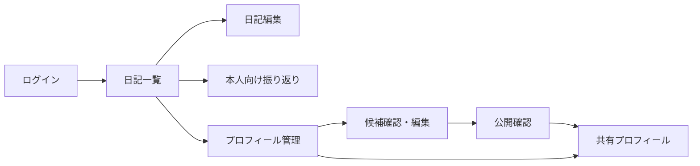
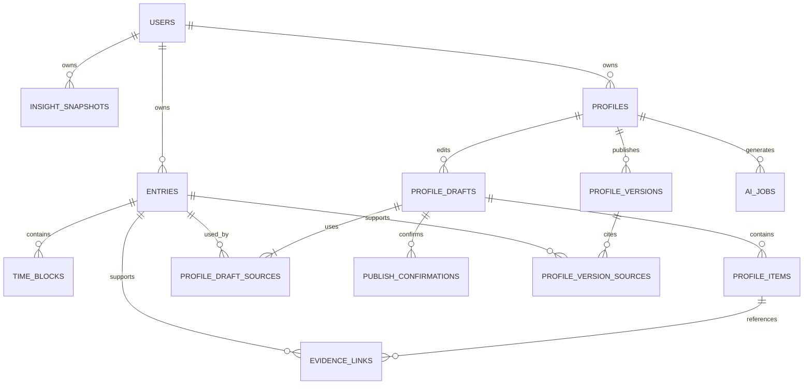

# IT学習・業務振り返りサービス 詳細設計書

## 1. 位置づけと前提

- 本書は[要件定義書](./要件定義書.md)の初期版を実装可能な単位に具体化する。
- 画面はWebアプリ、通信はHTTPSのJSON API、永続化はリレーショナルDBを想定する。特定のフレームワークやAI提供元には依存しない。
- 日記と本人向け分析は認証した本人のみ利用できる。採用プロフィールは本人が明示的に公開した版だけ共有できる。
- AIの出力は候補・推測として扱う。人格・健康状態・処理速度・マルチタスク能力を日記から断定しない。
- 以下で定める件数・文字数・期間は初期版の設計値であり、利用状況を見て調整する。

## 2. 画面構成

### 2.1 画面一覧

| ID | 画面・URL例 | 主な要素 | 権限 |
| --- | --- | --- | --- |
| S01 | ログイン `/login` | 認証、利用目的の説明 | 未ログイン |
| S02 | 日記一覧 `/entries` | 日付順一覧、期間検索、キーワード検索、新規作成 | 本人 |
| S03 | 日記編集 `/entries/new`, `/entries/{id}` | 自由文、任意の時間帯記録、原因の心当たり、対策・結果、保存・削除、公開版への影響表示 | 本人 |
| S04 | 本人向け振り返り `/insights` | 時間帯別の傾向、対策前後の変化、根拠期間、記録不足表示 | 本人 |
| S05 | プロフィール管理 `/profiles` | 作成開始、生成状況、下書き一覧、公開状況、公開停止、共有URL再発行 | 本人 |
| S06 | プロフィール編集 `/profiles/{id}/edit` | AI候補、根拠確認、掲載選択、文面編集、能力項目、プレビュー | 本人 |
| S07 | 公開確認 `/profiles/{id}/publish` | 公開される内容・URLの最終確認、公開実行 | 本人 |
| S08 | 共有プロフィール `/p/{shareToken}` | 承認済み概要、事例、根拠説明、レーダーチャート、面接質問案 | URLを知る人 |
| S09 | 設定 `/settings` | アカウント、共有リンクの状態確認・再発行、データ削除 | 本人 |

### 2.2 画面間の導線



日記画面からプロフィール作成へは明示的な操作で移動する。日記入力中に採用向け点数や公開を促さない。

### 2.3 画面共通の振る舞い

- 保存中・保存成功・保存失敗を明示し、未保存で画面を離れる場合は警告する。
- 空の一覧、分析に必要な記録不足、AI生成失敗、公開停止済みリンクをそれぞれ専用の状態として表示する。
- フォームはキーボード操作、スクリーンリーダー、スマートフォン幅で利用できるようにする。グラフには数値と文章の代替表示を付ける。
- 白い紙の質感は低コントラストの背景装飾として使い、本文・フォーム・グラフの可読性を優先する。余白、落ち着いた配色、整った文字組みで高級感を表現する。
- 公開プロフィールの参照元になっている日記を編集する場合、S03の保存前に「日記を変更しても公開中のプロフィールは自動更新されません」と表示し、該当プロフィールの確認・公開停止・再作成への導線を置く。保存後も見直しが完了するまでS03とS05に注意表示を残す。保存直前に影響範囲を取得し、該当する公開版があれば本人の確認を得る。取得後に影響範囲が変わった場合は入力を保持し、最新の内容で確認し直す。

## 3. 状態遷移

### 3.1 日記編集

| 現在状態 | 操作・条件 | 次状態 | 処理 |
| --- | --- | --- | --- |
| 未保存 | 入力 | 編集中 | 画面内に変更を保持 |
| 編集中 | 保存 | 保存中 | 入力検証後にAPI送信 |
| 保存中 | 成功 | 保存済み | 更新日時と版番号を反映 |
| 保存中 | 検証・通信エラー | 編集中 | 入力を保持しエラーを表示 |
| 保存済み | 変更 | 編集中 | 未保存警告を有効化 |
| 保存済み | 削除確認・実行 | 削除済み | 本文と時間帯記録を消去し、派生データを無効化・消去 |

日記は公開状態を持たない。初期版は明示的な保存ボタンを使用する。

### 3.2 AI生成ジョブ

`queued → running → succeeded`、`queued/running → failed`、または参照日記の削除による `queued/running → cancelled`。失敗時は本人に理由の概要と再実行操作を表示する。ジョブの再実行は新しいジョブとして記録し、過去の結果を上書きしない。

### 3.3 プロフィール

編集状態 `draft / generating / review` と公開状態 `never_published / published / unpublished` を**別々に保持**する。これにより、編集状態が `review` でも公開状態は `published` のままであり、公開停止できる。

| 編集状態 | 操作 | 次の編集状態 | 公開版への影響 |
| --- | --- | --- | --- |
| `draft` | AI生成依頼 | `generating` | なし |
| `generating` | 成功／失敗 | `review`／`draft` | なし |
| `draft`・`review` | 選択・編集 | `review` | なし。確認済み版を失効 |
| `review` | 最終確認して公開 | `review` | 新版を公開 |

| 公開状態 | 操作 | 次の公開状態 | 共有トークン |
| --- | --- | --- | --- |
| `never_published`・`unpublished` | 確認済み下書きを公開 | `published` | 新規発行 |
| `published` | 確認済み新版を公開 | `published` | 旧版を失効し、新規発行 |
| `published` | 公開停止（編集状態は `draft`・`generating`・`review` のいずれでも可） | `unpublished` | 現行版を失効 |

- 公開中に編集しても、再公開までは旧公開版を表示する。`review` 中の公開停止APIは現在の公開版を失効させ、下書きを保持する。
- 新版公開は、**旧公開版の失効、旧トークン無効化、新版作成、現行版の切り替えを単一DBトランザクション**で行う。旧共有URLは以後 `404` とし、新URLへ転送しない。
- 公開停止は、そのプロフィールの失効していない公開版をすべて失効させる。通常は現行版1件だが、過去版が残っていても閲覧できない。再公開時は必ず新しいトークンを発行する。
- 共有URLを失った場合は、本人が公開中プロフィールの共有URLを**再発行**できる。現在の公開版と内容は維持し、旧トークンを無効化して新トークンに置き換える。旧URLは `404` となる。
- 日記を編集しても公開スナップショットは自動変更しない。公開版の参照元日記を編集した場合は該当プロフィールを「要見直し」にし、本人に公開停止または新しい下書きからの再作成を案内する。公開版の根拠となった日記を**削除**した場合は、関連する公開版を自動で失効させる（5.3節）。
- 公開操作は、掲載内容と公開範囲を示す確認画面を経て行う。

## 4. API設計

### 4.1 共通規約

- ベースパス：`/api/v1`。本人向けAPIはセッション認証を必須とし、Cookie方式なら `HttpOnly`、`Secure`、`SameSite=Lax` とCSRF対策を適用する。
- リソースIDは推測しにくいUUID。時刻はISO 8601、保存はUTC、表示はユーザーのタイムゾーンとする。
- 更新APIは `version` を受け取り楽観ロックを行う。競合は `409 CONFLICT` とし、他の端末の変更を黙って上書きしない。
- 一覧は `cursor` と `limit`（最大50）でページングする。本文検索は本人の記録に限定する。
- エラー形式：`{"error":{"code":"VALIDATION_ERROR","message":"...","fields":{}}}`。主なコードは `UNAUTHENTICATED`、`FORBIDDEN`、`NOT_FOUND`、`VALIDATION_ERROR`、`CONFLICT`、`RATE_LIMITED`、`AI_UNAVAILABLE`。
- 書き込みは所有者をDB検索条件に含めて認可する。公開APIは公開スナップショットのみを読む。

### 4.2 本人向けAPI

| メソッド・パス | 用途 | 主な入力 | 主な出力 |
| --- | --- | --- | --- |
| `GET /me` | 本人と設定の取得 | なし | ユーザーID、表示名、タイムゾーン |
| `GET /entries` | 日記一覧・検索 | `from`, `to`, `q`, `cursor`, `limit` | 日記の要約一覧、次カーソル |
| `POST /entries` | 日記作成 | 記録日、本文、任意の時間帯記録 | 日記ID、版番号 |
| `GET /entries/{id}` | 日記詳細 | ID | 本文、時間帯記録、版番号、参照している公開プロフィールIDと要見直し状態 |
| `GET /entries/{id}/publication-impact` | 保存前の公開版への影響を取得 | ID | 現行公開版のプロフィールID・公開版IDの集合と、その集合に対応する影響確認トークン（0件の場合も発行） |
| `PATCH /entries/{id}` | 日記更新 | `version`、変更フィールド、影響確認トークン、影響がある場合は本人の確認フラグ | 更新後の日記、版番号、影響を受けた公開プロフィールID。影響範囲の変更時は `409 CONFLICT` |
| `DELETE /entries/{id}` | 日記と派生データの削除 | `version` | `204`。関連する公開URLも必要に応じ失効 |
| `GET /insights` | 本人向け傾向取得 | `from`, `to` | 件数、時間帯集計、AIによる仮説と根拠 |
| `GET /profiles` | プロフィール管理一覧 | なし | 編集状態、公開状態、公開日時、共有URLの有無、要見直し状態 |
| `POST /profiles` | 空の下書き作成 | 任意のタイトル | プロフィールID、編集状態 `draft`、公開状態 `never_published` |
| `POST /profiles/{id}/generations` | AI候補生成 | 対象期間、対象日記ID、`Idempotency-Key` | ジョブID、状態 `queued` |
| `GET /jobs/{id}` | 生成状況取得 | ジョブID | 状態、失敗理由の概要 |
| `GET /profiles/{id}` | 下書き・候補取得 | ID | 編集内容、候補、本人だけが見られる根拠参照 |
| `PATCH /profiles/{id}` | 候補選択・編集・項目承認 | `draftRevision`、項目IDごとの内容と `approvalState` | 更新後の下書き、増分した版番号 |
| `GET /profiles/{id}/preview` | 承認済み項目の公開プレビュー | なし | `draftRevision`、公開内容、`payloadHash` |
| `POST /profiles/{id}/confirmations` | 表示した内容の最終確認を保存 | `draftRevision`、`payloadHash`、確認フラグ | 確認ID、確認対象版・ハッシュ |
| `POST /profiles/{id}/publish` | 確認済み版を公開 | `confirmationId`、`draftRevision`、`payloadHash`、`Idempotency-Key` | 公開版ID、新しい共有URL |
| `POST /profiles/{id}/unpublish` | 公開停止 | `Idempotency-Key` | 公開状態 `unpublished`。編集中でも実行可 |
| `POST /profiles/{id}/share-links/rotate` | 共有URL再発行 | 本人の確認フラグ | 新しい共有URL。有効な旧URLは直ちに失効 |
| `GET /profiles/{id}/versions` | 公開履歴確認 | ID | 公開日時・版番号の一覧 |

`POST /entries` の入力例：

```json
{
  "entryDate": "2026-11-03",
  "body": "午前は設計を進めた。午後は資料確認中に眠気を感じた。",
  "timeBlocks": [
    {
      "startedAt": "2026-11-03T10:00:00+09:00",
      "endedAt": "2026-11-03T11:30:00+09:00",
      "state": "focused",
      "activity": "設計",
      "perceivedCause": "着手前に要件を整理した",
      "countermeasure": null,
      "outcome": null
    }
  ]
}
```

`state` は `focused`、`unfocused`、`sleepy`、`other`。時間帯記録は0件でもよい。`perceivedCause` は本人の心当たりとして保存し、AIの推測とは混同しない。

`approvalState` は各掲載項目の `candidate / approved / excluded`。概要、事例、能力項目、質問案の**各項目**にIDと承認状態を持たせる。編集した項目は `candidate` に戻し、再承認が必要となる。`preview` は承認済み項目だけから公開内容を組み立て、そのハッシュと下書き版番号を返す。本人が表示内容を確認した操作で `confirmations` を作成し、サーバーが同じ内容を再計算して版番号・ハッシュを照合する。`publish` は未失効の確認ID、同じ下書き版番号・ハッシュを照合し、いずれかが異なれば `409 CONFLICT`。未承認項目が混在しても公開版には含めない。承認済み項目が0件なら `422 VALIDATION_ERROR`。確認IDは1回限り利用でき、下書きの変更・日記の削除・公開停止で失効する。

共有URLの再発行は `publication_status = published` かつ現行公開版がある場合のみ許可する。それ以外は `409 CONFLICT`。サーバーは現行版の `share_token_hash` をトランザクション内で新しい値に置き換え、平文トークンを**その応答で1回だけ**返す。既存URLの復元・再表示はできないため、管理画面には「URLを再発行」と表示し、旧URLが無効になることを確認する。通信失敗で応答を失った場合も再発行操作をやり直せる。公開内容・版番号・承認状態は変更しない。

### 4.3 公開API

| メソッド・パス | 用途 | 出力 |
| --- | --- | --- |
| `GET /public/profiles/{shareToken}` | 共有プロフィール表示 | 公開版の概要、承認済み事例・能力項目・質問案、公開日時 |

- 公開レスポンスには日記ID、日記本文、時間帯記録、原因の心当たり、非採用候補、AIの内部推論、所有者のメールアドレスを含めない。
- 公開される「根拠」は本人が編集・承認した説明文と成果物への明示的なリンクに限る。
- 無効・期限切れ・停止済みトークンは同じ `404` とする。共有リンクは検索エンジンに索引させない設定とする。
- 公開APIはトークンのハッシュで `revoked_at IS NULL` の**現行公開版**だけを引き、`public_payload_json` を返す。旧版のトークンは新版公開と同時に失効する。
- `/p/{shareToken}` のHTML、`GET /public/profiles/{shareToken}` のJSON、失効時の `404` はすべて `Cache-Control: no-store, max-age=0` と `Referrer-Policy: no-referrer` を返す。CDN・リバースプロキシでは両経路のキャッシュを無効にし、Service Workerにも公開内容を保存しない。静的なCSS・JavaScriptのみキャッシュ可能とする。
- 共有画面は初回表示、ブラウザーの戻る・進む（`pageshow`）、タブ復帰時に公開APIで有効性を再確認する。`pagehide` で表示内容を隠し、再確認中も以前の内容を表示しない。失効・通信失敗時は内容を消して専用画面を表示する。既に閲覧者が保存したコピーや画面写真まで消去する保証はしない。

## 5. データモデル

### 5.1 関係図



### 5.2 テーブル

| テーブル | 主な列 | 制約・用途 |
| --- | --- | --- |
| `users` | `id`, `display_name`, `timezone`, `created_at` | 認証主体。認証方式固有の情報は別管理 |
| `entries` | `id`, `user_id`, `entry_date`, `body`, `version`, `created_at`, `updated_at`, `deleted_at` | 本人の日記。未削除時の `body` は1～20,000文字。削除時は墓標行を残し本文を `NULL` にする |
| `time_blocks` | `id`, `entry_id`, `started_at`, `ended_at`, `state`, `activity`, `perceived_cause`, `countermeasure`, `outcome`, `sort_order` | 任意の時間帯記録。開始 < 終了。同一日記内で重複は警告し、保存可否はUIで確認 |
| `insight_snapshots` | `id`, `user_id`, `period_start`, `period_end`, `source_entry_ids_json`, `source_revision`, `facts_json`, `hypotheses_json`, `generated_at` | 本人向け分析のキャッシュ。参照日記を追跡し、削除時に消去 |
| `profiles` | `id`, `user_id`, `title`, `editing_status`, `publication_status`, `published_source_changed_at`, `current_draft_id`, `published_version_id`, `version`, `created_at`, `updated_at` | 編集状態と公開状態を独立して保持。参照元日記を編集した時刻で「要見直し」を示す |
| `profile_drafts` | `id`, `profile_id`, `revision`, `updated_at` | 編集案の版。公開版とは分離。承認・公開時には参照元日記の集合を必ず持つ |
| `profile_draft_sources` | `draft_id`, `entry_id`, `entry_version` | 生成時にAIへ送った全日記と、後から手動で参照した日記を記録。参照時の日記版を固定し、下書き単位の削除依存関係を記録 |
| `profile_items` | `id`, `draft_id`, `kind`, `content_json`, `approval_state`, `item_revision`, `updated_at` | `kind` は `summary/case/competency/question`。各項目の掲載可否を保存。編集時は `candidate` に戻す |
| `evidence_links` | `id`, `item_id`, `entry_id`, `candidate_text`, `approved_text` | 候補項目と日記の対応。公開時は承認済み説明だけを複製 |
| `publish_confirmations` | `id`, `draft_id`, `draft_revision`, `payload_hash`, `confirmed_payload_json`, `confirmed_at`, `used_at`, `invalidated_at` | 最終確認した内容と版を固定。変更後の確認IDは無効 |
| `profile_versions` | `id`, `profile_id`, `version_no`, `source_draft_revision`, `confirmation_id`, `public_payload_json`, `payload_hash`, `published_at`, `revoked_at`, `share_token_hash`, `share_token_issued_at`, `expires_at` | 公開時の不変スナップショット。共有トークンのハッシュだけ保存し、再発行時はハッシュを置換。プロフィールごとに未失効版は最大1件。根拠日記削除時は失効し、ペイロードを `NULL` にする |
| `profile_version_sources` | `version_id`, `entry_id` | 公開版を作った下書きの参照元日記を**全件複製**。公開APIには出さない |
| `ai_jobs` | `id`, `user_id`, `profile_id`, `type`, `status`, `source_entry_ids_json`, `result_json`, `error_code`, `created_at`, `finished_at` | 生成処理の履歴。削除日記を参照する結果は即時消去 |

能力項目のキーは `design`、`implementation`、`problem_solving`、`collaboration`、`learning_improvement`、`self_management`。各項目は `score`（1～5または `null`）、`evidenceStatus`（`supported/insufficient`）、`reason`、承認済み根拠説明を持つ。**根拠不足は `score: null` としてグラフに欠損表示し、0点や最低点に変換しない。** スコアは絶対的な採用判定値ではなく、根拠付き事例を探すための補助表示とする。

スコア候補の暫定基準は、1＝経験の記述がある、2＝支援を受けて実行した、3＝定型的な課題を自分で完了した、4＝複雑な課題で判断・改善した、5＝他者への展開や再現可能な仕組み化まで示した、とする。各能力項目でその水準を示す**具体的な行動と結果**が確認できる場合に限り候補点を付ける。根拠が曖昧な場合は `null` とし、本人の承認前に公開しない。この尺度の妥当性は実装前に確認する。

### 5.3 整合性・保護

- **ロックの共通規約**：日記の更新・削除、参照元の登録・変更、生成ジョブの作成・結果保存、分析キャッシュの保存、下書きの変更・破棄、確認・公開・公開停止・共有URL再発行など、日記と派生データの依存関係や公開状態を変更する全トランザクションは、最初に対象本人の `users` 行を `SELECT ... FOR UPDATE` する。同一ユーザーのこれらの書き込みは直列化し、外部AI呼び出しや利用者の操作待ちの間はロックを保持しない。以降のロック順は、日記、プロフィール、下書き、ジョブ、公開版、確認、参照行の順とし、同種の行は主キー昇順（複合キーは各列の辞書順）とする。途中から不足する上位種別の行を追加ロックせず、いったんロールバックして最初から取得し直す。全経路でこの順序を守り、DBのデッドロック・シリアライズ失敗時も全トランザクションをロールバックして、回数を制限した再試行を行う。再試行を使い切った場合は変更を確定せず、再操作可能なエラーを返す。
- 日記削除は本人の `users` 行をロック後、対象日記を参照する下書き・公開版・ジョブ・分析キャッシュと、それらの下書き・公開版が参照する全日記を特定する。対象日記を含む日記集合、関連プロフィール、下書き、ジョブ、公開版、確認、および削除する参照行を上記の順序でロックする。分析キャッシュ行はジョブ行の後、公開版行の前にID昇順でロックする。対象集合と参照関係、現行公開版をロック後に再取得して照合し、差があれば何も変更せずロールバックして最初から再試行する。共通規約に従う同一ユーザーの書き込みは本人行で待機するため、取得中の依存関係は安定する。削除対象の日記が既に削除済みなら、再試行時に通常の削除済み応答を返す。関連行の消去と墓標化は検証後に同一トランザクションで行う。

- `entries(user_id, entry_date, id)`、`time_blocks(entry_id, started_at)`、`profiles(user_id, updated_at)` に索引を付ける。
- `profile_versions(profile_id)` には `revoked_at IS NULL` の一意制約を設け、同じプロフィールの有効な公開版を最大1件にする。`share_token_hash` は全体で一意とする。
- 日記の本文・時間帯記録を更新するトランザクションでは、対象日記をロックし、`profile_version_sources` から現行公開版のプロフィールID・公開版IDの集合を再取得する。サーバーが発行した影響確認トークンを本人・日記・日記版と照合し、その集合が現在の集合と一致し、集合が空でなければ本人の確認フラグもある場合のみ更新する。不一致やトークン不正時は変更せず `409 CONFLICT` を返す。クライアントは最新の影響範囲を取得し直し、必要なら本人の確認を得て再送する。公開版を切り替える処理は本人行の後に旧版と新版の参照日記の和集合をロックするため、影響確認と更新の間に対象日記に関する公開版の追加・切り替えが割り込まない。更新時は該当する `profiles.published_source_changed_at` を更新する。公開停止しても下書きは保持する。
- 生成対象の日記を読み取る際は、全対象行をID昇順にロックして本文と版を一貫して取得し、各版を `profile_draft_sources.entry_version` に記録する。手動で参照元を追加する場合も同様にその版を記録する。既存参照元の版を単に現在の版に更新して古い候補を維持してはならない。日記が更新された場合は、その日記を参照する下書きを古い状態として扱い、新しい下書きを作成・再生成する。AI結果保存時も保存済みの全参照版と現在の日記版を照合し、不一致なら結果を破棄してジョブを失敗させる。公開時も同じロック下で全参照版を照合し、不一致なら `409 CONFLICT` として公開を拒否する。一致する新版を公開した場合に限り `published_source_changed_at` を `NULL` に戻す。
- 初期版では、概要・事例・能力項目・面接質問案を含む**全掲載項目が日記由来**とする。AI生成前に対象日記を `profile_draft_sources` に全件登録し、手動追加・編集で別の日記を参照するときも同表に登録する。登録時は対象日記行をロックし、未削除・本人所有を確認してから参照元行を作る。参照元が0件の下書きは項目承認・最終確認・公開を拒否する。生成処理は選択した日記以外を読まない。参照元を減らしたい場合は下書きを破棄して再生成する。
- 公開時は `profile_draft_sources` の集合を `profile_version_sources` に全件複製し、件数とIDの一致を同じトランザクションで検証する。AI出力に項目ごとの `evidence_links` がなくても、下書き・公開版全体が参照元日記の削除に連動する。
- 新版公開時は本人行をロックした後、現行公開版IDと旧版・新版それぞれの参照日記ID集合を読み取り、両集合の和集合に含まれる日記行をID昇順でロックする。その後プロフィール行と必要な下書き行をロックし、現行公開版IDと両参照集合が読み取り時から変わっていないことを再確認する。変化していた場合はトランザクションを中止し、最初から取得・ロックし直すか `409 CONFLICT` を返す。再確認後に新版の参照日記の未削除・版一致を検証し、旧版失効と新版作成を行う。初回公開では旧集合は空とする。公開停止や日記削除を含む関連処理も、本人行を最初にロックした後、必要な日記行をID昇順でプロフィール行より先にロックし、ロック後に対象の現行版と参照集合を再確認する。
- 各日記・プロフィール・ジョブの参照時に所有者を確認する。IDだけで取得しない。
- 公開用データは `profile_versions.public_payload_json` からのみ返す。日記テーブルとの結合を公開APIで行わない。
- 日記削除は上記のロックと再確認を終えた単一DBトランザクションで、(1) 対象日記に対して `deleted_at` 設定・`body = NULL`・時間帯記録の物理削除、(2) その日記を含む分析キャッシュとAIジョブの `result_json`・入力参照IDの消去、実行中ジョブの `cancelled` 化、(3) `profile_draft_sources` で参照する**下書き全体**の全項目・根拠リンク・確認済みペイロードの消去と確認IDの失効、(4) `profile_version_sources` で参照する**現行版・過去版すべて**の公開ペイロード消去を実施する。現行版が該当する場合は同時に失効・共有トークン無効化し、`publication_status = unpublished` にする。影響を受けた下書きは `draft` に戻し、本人に再生成を案内する。
- ワーカーがAI結果を保存する際は、**参照する全日記行をID昇順で `SELECT ... FOR UPDATE` し、ジョブ行をロックする同一トランザクション内**で、全日記の存在・`deleted_at IS NULL` とジョブ状態 `running` を再確認してから結果・下書き項目を保存する。条件を満たさなければ結果を破棄する。削除処理も本人行を最初にロックし、その後は共通規約の順序で日記行をジョブ行より先にロックする。ワーカーの保存が先なら削除処理がその結果を消去し、削除が先ならワーカーは保存できない。本人向け分析キャッシュの保存とプロフィール公開も、参照日記行を同順序でロックし削除状態を再確認する。
- `profile_draft_sources.entry_id`、`profile_version_sources.entry_id`、`evidence_links.entry_id`、`time_blocks.entry_id` は `entries.id` への外部キーを `ON DELETE RESTRICT` とする。論理削除トランザクション内で、影響を受ける下書き・公開版の**参照元行をすべて物理削除**し、根拠リンクと時間帯記録も削除する。公開版の失効メタデータは残してよいが、参照元IDと内容は残さない。
- 本文を消した日記の墓標行と内容を持たないジョブ実行メタデータは、参照整合性・障害調査のため30日後に物理削除する。定期削除処理は外部キー参照が0件であることを確認してから `entries` の墓標行を削除し、参照があれば削除を中止して障害通知する。カスケード削除で黙って消さない。ログにも日記本文やAI結果を記録しない。
- AIへ渡す記録は選択期間・選択IDに限定する。AIへの送信、保存期間、削除の実装条件は採用するAI提供元に合わせて確定する。

## 6. AI処理設計

### 6.1 本人向け分析

時間帯別の記録数や状態の分布はアプリ側で集計する。AIは集計結果と参照可能な記録から説明文を作る。事実、本人の原因仮説、AIが見いだした傾向を別フィールドに分け、対象期間と件数を添える。初期版では対象期間の記録が5日未満なら「傾向を判断するには記録が少ない」と表示し、傾向の断定を避ける。

### 6.2 プロフィール候補生成

1. 本人が対象期間と対象日記を選ぶ。サーバーは送信対象の全IDと読み取った日記の版を `profile_draft_sources` に保存する。
2. サーバーがその集合に属する本人の記録だけを抽出し、AIに構造化出力を要求する。
3. 出力スキーマ、文字数、参照元IDの実在と所有者、禁止項目を検証する。
4. 根拠のない能力項目を `insufficient` にする。候補を下書きに保存する。
5. 本人が候補と根拠を照合し、項目ごとに除外・編集・承認する。編集した項目は再承認する。
6. 最終確認では承認済み項目だけのプレビュー、下書き版番号、内容ハッシュを保存する。
7. 公開時には確認済みの版・ハッシュが現在の下書きと一致することを検証し、承認済みフィールドだけを許可リストで抽出して公開版を作る。参照元日記集合を公開版へ複製し、同じトランザクションで旧版を失効させる。

AIが生成した事例・能力理由には参照日記IDを内部情報として保持する。公開版には原文や内部IDを移さない。AI生成の失敗や不適切な出力があっても、日記や既存の公開版は変更しない。

## 7. テスト要件

### 7.1 画面構成のテスト

| 対象 | 確認事項 |
| --- | --- |
| S02・S03 | 自由文だけで保存できる。時間帯・原因・対策は空欄でもよい。未保存で離脱すると警告し、保存失敗でも入力が残る |
| S03 | 開始時刻が終了時刻以降なら入力エラー。時間帯の追加・編集・削除ができる。公開版の参照元日記を編集する場合は保存前に旧内容が公開され続ける旨と公開停止・再作成への導線を表示し、保存後も要見直し表示が残る |
| S04 | 事実・本人の仮説・AIの傾向が見分けられる。記録不足時に断定的な分析を出さない |
| S05～S07・S09 | AI候補の根拠を確認し、項目ごとに承認・除外・編集できる。公開確認に掲載内容と版がすべて表示される。編集中でも公開停止できる。共有URLを失った場合に再発行でき、旧URL無効化の説明が表示される |
| S08 | 非承認の内容が表示されない。欠損スコアは「根拠不足」と読める。公開停止・URL再発行後は旧URLで表示できない |
| 全画面 | モバイル幅、キーボード操作、フォーカス表示、色のコントラスト、グラフの文章代替、紙の質感が可読性を損なわないこと |

### 7.2 状態遷移のテスト

- 日記の保存成功・入力エラー・通信エラー・版競合・削除をそれぞれ再現し、入力保持と状態表示を確認する。
- 公開版の参照元日記を編集しても公開版が自動で変わらず、プロフィールが「要見直し」になることを確認する。最新の日記版から作った新版の公開で表示が解除されることを確認する。
- 生成・承認後に参照日記を編集した下書きは公開できず、生成中に参照日記が編集された場合は結果を保存しないことを確認する。最新の日記から再生成した下書きは確認後に公開できる。
- 端末Aで影響範囲を取得した後、端末Bで対象日記を参照するプロフィールを公開し、端末Aで保存すると `409` になり入力が残ることを確認する。最新の影響範囲と警告を表示し、本人が確認した後に保存できることを確認する。
- 日記Aを参照する旧公開版から、日記Bだけを参照する新版へ切り替える処理と、日記Aの更新を並行実行する。Aの更新が先にロックを得た場合は公開切り替えが待機し、新版に誤って「要見直し」が付かないことを確認する。公開切り替えが先の場合はAの更新時に影響範囲の変更を検出して `409` とし、最新の影響範囲を再取得できることを確認する。現行版や参照集合がロック取得前に変化した場合も再試行または競合応答となることを確認する。
- AIジョブの成功・失敗・再実行・同一冪等キーの再送で重複生成しないことを確認する。
- 編集状態の `draft → generating → review` と公開状態の `never_published → published → unpublished` を通しで確認する。
- 編集状態と公開状態が独立していることを確認する。公開状態 `published` のまま編集状態 `review` に移り、そこから公開停止できることを確認する。
- 公開中に編集しても旧公開版が変わらず、新版公開と同時に旧URLが `404`、新URLだけが `200` になることを確認する。
- 公開停止が有効な全トークンを失効させ、再公開後も古い共有トークンが復活しないことを確認する。
- 共有URL再発行後は現行公開版の内容・版番号が変わらず、旧URLが `404`、新URLが `200` になることを確認する。

### 7.3 APIテスト

- 各本人向けAPIで未認証 `401`、他人のリソース `404` または `403`、入力不正 `422`、版競合 `409` を確認する。
- 日記一覧の期間・検索・ページングが本人のデータだけを返すことを確認する。
- `GET /entries/{id}`、影響取得API、`PATCH /entries/{id}` が、本人にだけ公開版への影響を返し、他人のプロフィールIDを漏らさないことを確認する。影響確認トークンの改ざん・他の日記への流用・日記版や公開版集合の変更を拒否し、公開版0件の場合も確認後の競合を検出する。
- 時間帯の不正な順序、未知の状態値、本文上限超過、存在しない根拠IDを拒否する。
- 公開APIのレスポンスをスキーマ検査し、日記本文・時間帯・本人の原因仮説・内部ID・メールアドレスが含まれないことを確認する。
- 無効・停止済み・期限切れ共有トークンの応答が同じ `404` であることを確認する。
- `review` 中の `unpublish` が現行版を失効させ、下書きを消さないことを確認する。
- 項目編集後に旧確認IDで公開すると `409` になること、未承認項目が公開ペイロードに入らないこと、確認したハッシュと異なる内容を公開できないことを確認する。
- 新版公開と公開停止の同時実行、二重公開の同時実行でも有効な公開版が最大1件であり、失効済みURLが再び有効にならないことを確認する。
- URL再発行は本人かつ公開中のみ許可され、他人・公開停止中は実行できないことを確認する。平文トークンがDB・ログに残らないことを確認する。
- 公開ページのHTML・API・`404` に `Cache-Control: no-store, max-age=0` と `Referrer-Policy: no-referrer` が付くこと、CDN・Service Workerが公開内容を保存しないことを確認する。停止後、同じURLへの再アクセス、戻る・進む、タブ復帰で古い内容が表示されないことをブラウザーで確認する。
- 公開・生成APIの冪等性、CSRF対策、レート制限を確認する。

### 7.4 データモデルのテスト

- 外部キー、所有者の整合性、時刻の前後関係、版番号、スコアの範囲と `null` の扱いを確認する。
- 日記削除完了時点で、本文・時間帯記録・分析キャッシュ・AI結果・未公開候補から該当内容が消え、実行中ジョブが後から内容を再保存しないことを確認する。
- AI結果保存が日記削除より先にロックを得る場合は、保存結果を削除側が消去することを確認する。削除が先にロックを得る場合は、ワーカーが結果を保存できないことを確認する。同じ競合を分析キャッシュ保存とプロフィール公開にも適用する。
- 概要・事例・能力項目・面接質問案がすべて参照元集合を持つ下書きに属し、参照元なしでは承認・公開できないこと、公開版の参照元集合が下書きと一致することを確認する。複数日記を使った生成結果では、いずれか1件の削除で下書き全体が消去されることを確認する。
- 削除日記を根拠にした現行公開版が失効し、現行・過去の公開ペイロードと確認済みペイロードが消去されることを確認する。30日後の墓標・ジョブメタデータ削除も確認する。
- 複数日記を参照する下書き・公開版から1件を削除した場合、関連する `profile_draft_sources`・`profile_version_sources`・`evidence_links` が全件消えることを確認する。30日後の物理削除で外部キー違反が起きず、参照行が残れば削除を中止して障害通知することを確認する。
- 同じ下書きと公開版が日記A・Bを参照する状態で、AとBを別トランザクションから同時削除する。両方の開始順を入れ替え、本人行で直列化され、両削除が完了し、派生内容と参照行が残らず、デッドロックしないことを確認する。依存関係の再確認で差異を検出した場合とDBがデッドロック・シリアライズ失敗を返した場合は、部分変更を残さずロールバックし、上限付きで最初から再試行することも確認する。
- 公開スナップショットが下書き編集・元日記の通常更新で変化しないこと、旧版・停止版のトークンが無効になることを確認する。
- マイグレーションを空DBと既存データ入りDBの両方で実行し、制約と索引を確認する。

### 7.5 AI出力のテスト

- 根拠のない評価、人格・健康・処理速度の断定、記録にない成果の捏造を含む出力を公開候補として採用しない。
- AIが存在しない日記ID、他人の日記ID、スキーマ外のフィールドを返した場合に検証で拒否する。
- 記録が少ない場合に `score: null` と「根拠不足」を維持する。
- AI停止・タイムアウト・不正出力時に再試行でき、既存の日記と公開プロフィールが保持される。

### 7.6 主要な受け入れシナリオ

1. 利用者が自由文だけで日記を作成し、後から時間帯・眠気・原因の心当たり・対策を追加する。
2. 本人向け画面で、事実と仮説を区別した傾向を確認する。記録不足ならその旨が表示される。
3. 本人がプロフィールを作成し、AI候補の根拠を確認して項目ごとに除外・編集・承認する。
4. 最終確認した下書き版を公開し、共有URLで承認した内容だけが見えることを確認する。
5. 公開中の内容を編集しても共有画面は変わらず、新版公開時に旧URLが失効して新URLへ切り替わる。
6. 公開版を編集中に公開停止し、以前の共有URLから閲覧できないことを確認する。
7. 公開版の根拠となる日記を削除し、関連するキャッシュ・AI結果・公開内容とURLが失効することを確認する。
8. 公開中の共有URLを失った本人が再発行し、新URLを共有でき、旧URLでは表示できないことを確認する。
9. 公開版の根拠となる日記を編集し、旧内容の公開継続を示す警告から公開停止またはプロフィール再作成へ進めることを確認する。

## 8. 実装前に確定する事項

- 認証方式とアカウント削除後のデータ消去手順。
- AI提供元、送信データの取り扱い、保存期間、障害時の再試行方針。
- 共有リンクの有効期限を必須にするかどうか。
- レーダーチャートの暫定基準を能力項目ごとに具体化する方法と、採点の妥当性を確認する運用方法。採点が妥当と確認できるまでは「根拠付きの事例一覧」を主表示とする。
- 成果物リンクを初期版に含める場合の対象サービスと公開確認方法。
